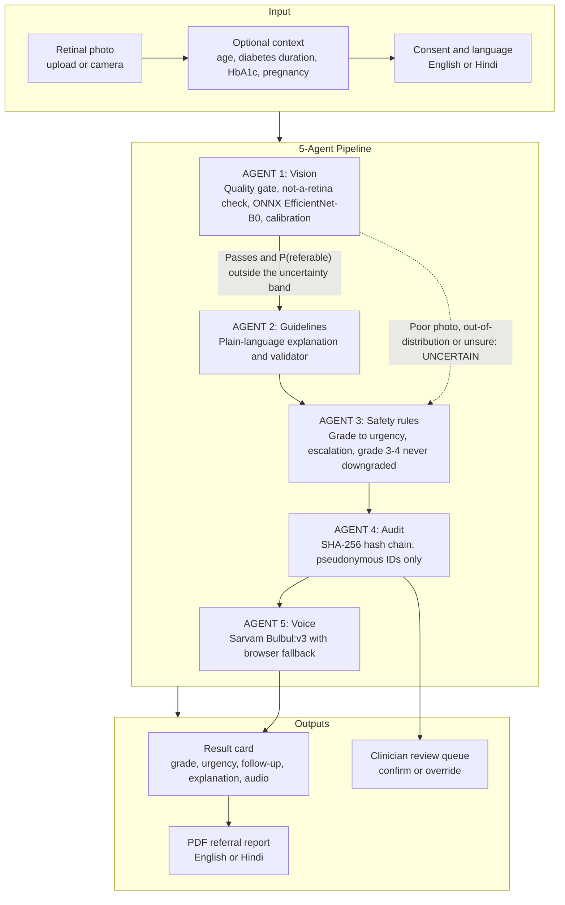

<div align="center">

  <h1>RetinaGuard</h1>

  <p align="center">
    <strong>AI-Assisted Diabetic Retinopathy Screening, Deterministic Referral Rules & a Tamper-Evident Audit Trail</strong>
  </p>

  <p align="center">
    <a href="https://github.com/rishu-o2/RetinaGuard/actions"></a>
    
    <a href="https://onnxruntime.ai"></a>
    <a href="https://fastapi.tiangolo.com"></a>
    <a href="https://react.dev"></a>
    <a href="https://www.sqlalchemy.org"></a>
    <a href="https://sarvam.ai"></a>
  </p>

</div>

---

> [!IMPORTANT]
> **Core Architectural Philosophy:** *Maximum Backend Complexity, Zero Frontend Friction.*
> A screener at a diabetologist clinic or a primary health centre should not have to manage forms, thresholds or reports. They log in, upload one retinal photo and read one result card. Behind that card, a quality gate, an out-of-distribution check, a calibrated ONNX model, a deterministic rules engine, a clinician review queue, a hash-chained audit log and a spoken-advice engine decide what is safe to say.

> [!CAUTION]
> **Research prototype. Not a medical device and not clinically validated.**
> RetinaGuard is decision support for a clinician, never an autonomous diagnosis. It has been tested only on public datasets (APTOS 2019 and IDRiD) and has **no validation on portable or smartphone fundus cameras**. Do not use it on real patients. Use public datasets or consented, de-identified images only. Every clinical threshold in `configs/` is marked `NEEDS CLINICAL REVIEW`.

---

## 📌 Table of Contents
1. [The Problem](#-the-problem)
2. [The RetinaGuard Approach](#-the-retinaguard-approach)
3. [The 5-Agent Pipeline](#-the-5-agent-pipeline)
4. [Safety Model](#-safety-model)
5. [Quality and OOD Gates](#-quality-and-ood-gates)
6. [Model and Data](#-model-and-data)
7. [Measured Results](#-measured-results)
8. [Clinician Workflow and Simple UI](#-clinician-workflow-and-simple-ui)
9. [Voice and Language](#-voice-and-language)
10. [Privacy and Security](#-privacy-and-security)
11. [API Reference](#-api-reference)
12. [Automated Verification](#-automated-verification)
13. [Quick Start](#-quick-start)
14. [Reproduce the Model](#-reproduce-the-model)
15. [Repository Layout](#-repository-layout)
16. [Roadmap and Known Limits](#-roadmap-and-known-limits)
17. [Disclaimer and Credits](#-disclaimer-and-credits)

---

## 🚨 The Problem

Diabetic retinopathy (DR) damages the retina of people with diabetes and is a leading cause of preventable vision loss. Early disease usually has no symptoms, so it is found only if someone looks.

1. **Silent progression.** By the time vision changes, treatment options are narrower.
2. **Scarce specialists.** Retinal screening depends on ophthalmologists, who are concentrated in cities. Many people with diabetes in India live far from one.
3. **Scale.** An estimated 101 million people live with diabetes in India (ICMR-INDIAB, 2023), and roughly 17% of people with diabetes in a large Chennai population study (CURES Eye Study) had DR. *Verify these figures against the original sources before citing them.*
4. **Unsafe automation.** A system that always returns a confident answer can send a person with sight-threatening disease home. Poor photos, unusual images and unfamiliar cameras make this worse.
5. **Opaque results.** Screeners and patients need a plain-language result in their own language, and clinicians need an auditable record of what the system said and who confirmed it.

---

## 💡 The RetinaGuard Approach

RetinaGuard is built around one rule: **the model predicts, fixed rules decide, and a language component only explains.**

* **Quality gate first.** Blurry, dark, badly framed or too-small photos are rejected with a "retake the photo" message instead of being graded.
* **Not-a-retina check.** Blank images, ordinary photos, documents and other out-of-distribution inputs are rejected before the model sees them.
* **Calibrated ONNX model.** An EfficientNet-B0 with a dual head (5-class grade logits plus 4 ordinal logits) predicts the 5-level ICDR grade. Temperature scaling, fitted on the validation split only, makes the probabilities usable. The ONNX file runs on a standard CPU.
* **Abstention, not guessing.** When the probability of referable disease sits near the referral cutoff, the answer is `UNCERTAIN`, never a confident "no DR".
* **Deterministic rules engine.** Plain, unit-tested Python turns grade, calibrated probabilities and optional patient context into referral status, urgency and a follow-up interval. Grades 3 and 4 are never downgraded.
* **Sight-threatening escalation.** Even when the predicted grade is mild, a high probability of grade 3 or 4 raises urgency.
* **Guideline-grounded explanations.** A guideline agent writes a plain-language explanation from pre-defined clinical templates (and, once guideline documents are added, cited passages). A validator rejects any text that contradicts the grade, urgency or interval.
* **Clinician in the loop.** Every result, including `UNCERTAIN` ones, lands in a review queue where a clinician confirms or overrides it.
* **Tamper-evident audit.** Each result and review is appended to a SHA-256 hash chain that can be verified end to end.
* **Referral report and voice.** A server-side PDF referral letter (English or Hindi) and spoken advice through Sarvam AI Bulbul:v3, with a browser speech fallback.

---

## 🤖 The 5-Agent Pipeline



| Agent | Responsibility | Code |
| :--- | :--- | :--- |
| **1. Vision** | Quality gate, not-a-retina check, ONNX inference, temperature-calibrated probabilities, early exit to `UNCERTAIN` | `backend/src/retinaguard/agents/vision_agent.py` |
| **2. Guidelines** | Plain-language explanation from templates or retrieved guideline passages, with a validator | `backend/src/retinaguard/agents/guideline_agent.py` |
| **3. Safety** | Calls the deterministic rules engine for referral, urgency and follow-up | `backend/src/retinaguard/agents/safety_agent.py` |
| **4. Audit** | Appends a pseudonymous record to the hash-chained ledger | `backend/src/retinaguard/agents/audit_agent.py` |
| **5. Voice** | Builds the spoken text and synthesises audio with fallbacks | `backend/src/retinaguard/agents/voice_agent.py` |

The early exit still passes through the safety, audit and voice agents, so **every** screening, including a rejected photo, is logged and reaches the clinician queue.

---

## 🔒 Safety Model

| Component | May | Must never |
| :--- | :--- | :--- |
| **Vision model** | Predict a grade and class probabilities | Decide referral or urgency |
| **Rules engine** | Map grade, probabilities and patient context to referral, urgency and follow-up | Use ML or an LLM, or downgrade a grade 3 or 4 |
| **Guideline agent** | Explain a finished result in plain language and cite sources | Change the grade, urgency or follow-up interval |
| **Audit log** | Append tamper-evident records | Store images, names or direct identifiers |
| **Voice** | Read out generic advice | Receive patient identifiers |
| **Clinician** | Confirm or override any result | Override silently (every review is logged) |

**Calibrated probabilities and referral probability**

$$p_i = \mathrm{softmax}\!\left(\frac{z_i}{T}\right), \qquad P(\mathrm{referable}) = p_2 + p_3 + p_4$$

where $z_i$ are the grade logits and $T$ is the temperature fitted on the validation split (stored in `models/registry.json`).

**Abstention band.** The result is `UNCERTAIN` when the photo fails a gate, or when

$$0.30 \le P(\mathrm{referable}) \le 0.70$$

(cutoff 0.50, configured in `configs/abstention.yaml`). The policy deliberately favours not missing referable cases: when unsure, escalate to a human.

**Sight-threatening escalation.** Using the calibrated probability of grade 3 or 4,

$$P(\text{grade} \ge 3) = p_3 + p_4$$

| Condition | Minimum urgency |
| :--- | :--- |
| $P(\text{grade} \ge 3) \ge 0.05$ | `SOON` (follow-up within about 3 months) |
| $P(\text{grade} \ge 3) \ge 0.30$ | `URGENT` (follow-up within about 1 month) |

The escalation can only raise urgency. A property test proves it never lowers an urgency that was already higher. Patient-context modifiers (pregnancy, HbA1c, diabetes duration) are defined in `configs/clinical_rules.yaml`.

> [!NOTE]
> All thresholds, intervals and the grade-to-urgency mapping live in `configs/` and are marked `NEEDS CLINICAL REVIEW`. They are engineering placeholders chosen on validation data, not clinical guidance.

---

## 🔍 Quality and OOD Gates

Before any grade is produced, the photo must pass two gates.

| Check | What it does | Configuration |
| :--- | :--- | :--- |
| **Blur** | Laplacian variance of the cropped retina, resized to a fixed 512 px so the score does not depend on source resolution | `configs/quality_thresholds.yaml` |
| **Exposure** | Rejects under- and over-exposed images | `configs/quality_thresholds.yaml` |
| **Field of view** | Checks the circular aperture area and circularity | `configs/quality_thresholds.yaml` |
| **Resolution** | Minimum size matched to the 256 px model input | `configs/quality_thresholds.yaml` |
| **Optical spectrum** | A fundus photo is red-dominant (R > G > B); blank, black, outdoor and document images fail | `configs/ood_thresholds.yaml` |
| **Deep OOD score** | Max-softmax, energy and Mahalanobis distance on the model's 1,280-dimensional features, using statistics fitted on the training split (`models/ood_stats_v1.npz`) | `configs/ood_thresholds.yaml` |

Quality profiles exist for tabletop and smartphone cameras. The smartphone profile is a placeholder until real device images are collected. The blur threshold was chosen from the training-split distribution, and the Mahalanobis threshold is set at twice the 99th percentile of the training distances.

---

## 🧠 Model and Data

| Item | Detail |
| :--- | :--- |
| **Backbone** | EfficientNet-B0 (timm, ImageNet-pretrained), dual head: 5 categorical logits and 4 ordinal logits |
| **Input size** | 256 x 256 (border-cropped fundus image) |
| **Loss** | Class-weighted cross-entropy plus ordinal loss, with a single imbalance correction (class weights, no weighted sampler) |
| **Training data** | APTOS 2019 Blindness Detection: 3,662 labelled images |
| **Splits** | Group-aware 70/15/15: train 2,551, validation 559, test 552, with near-duplicate images kept in the same split (APTOS has no patient IDs) |
| **External test** | IDRiD (Indian retinal images): 516 images, used only for reporting, never for training or validation (enforced in code) |
| **Training hardware** | CPU-only laptop (no GPU required) |
| **Export** | ONNX opset 17, with a PyTorch-versus-ONNX parity test |
| **Model registry** | `models/registry.json` records version, checksum, config, input size and temperature |

Model weights, ONNX files and OOD statistics are **not stored in git**. Only `models/registry.json` is tracked. The full model card is in [`docs/MODEL_CARD.md`](docs/MODEL_CARD.md).

---

## 📊 Measured Results

Current checkpoint: EfficientNet-B0, 256 px, best validation epoch. Referable DR means grade 2 or higher. All numbers were measured by the scripts in `ml/` and will change if the model is retrained.

| Evaluation set | Images | QWK | Referable sensitivity | Referable specificity | Referable AUC |
| :--- | :---: | :---: | :---: | :---: | :---: |
| APTOS validation | 559 | 0.919 | 0.964 | 0.932 | 0.989 |
| APTOS held-out test | 552 | 0.900 | 0.960 | 0.920 | 0.975 |
| IDRiD, all images (different camera) | 516 | 0.748 | 0.749 | 0.959 | 0.940 |
| IDRiD, official test split | 103 | 0.632 | 0.750 | 0.897 | 0.889 |

QWK is quadratic weighted kappa. Bootstrap 95% confidence intervals are in the model card. Validation per-class recall: grade 0 = 0.99, grade 1 = 0.56, grade 2 = 0.75, grade 3 = 0.60, grade 4 = 0.38.

**What these numbers say**

* **Within APTOS the pipeline is consistent.** Validation and test scores agree closely. Both come from the same source and have no patient IDs, so some optimism from near-duplicate leakage may remain.
* **On a different camera, sensitivity drops by about 20 points.** The ranking ability (AUC) holds up, but the cutoff does not transfer, so more referable cases are missed. This is domain shift, and the confidence gates do not detect it. Fixing it needs data from the target cameras, not threshold tuning on IDRiD.
* **Severe and proliferative disease is under-called.** Grades 3 and 4 are often predicted as grade 2 or 3. This is why the probability-based escalation rule exists and why grade-3/4 recall is reported separately.
* **IDRiD grade 1 has only 25 images**, so any per-class figure for it has a wide interval.
* **Thresholds were chosen on the validation split only.** The test split and IDRiD were evaluated once for reporting, and nothing was tuned afterwards.

---

## 🩺 Clinician Workflow and Simple UI

The interface follows the rule *simple for the user, complex in the backend*.

**Screener (one screen):**
1. Log in.
2. Upload or capture a retinal photo. Optional context fields are collapsed.
3. Tick the consent box and choose English or Hindi.
4. Read one result card: grade, referral badge, urgency, follow-up, a plain-language explanation, a play-audio button and a **Download PDF** button.

**`UNCERTAIN` results** use a visually distinct warning card that says *retake the photo if possible* and *a clinician will review this*. They never look like a confident result.

**Clinician (one list):**
1. Log in and open the pending-review queue. `UNCERTAIN` cases carry a "needs recapture or review" flag.
2. Open a case and tap **Confirm** or **Override** (an override asks for the corrected grade and a short note).
3. The decision is appended to the audit chain and shown on the PDF.

Every result card and PDF carries a **"Prototype, not clinically validated"** banner. Admins create clinician and screener accounts through the API. Roles are `screener`, `clinician` and `admin`.

---

## 🔊 Voice and Language

* **Engine:** Sarvam AI Bulbul:v3 (`https://api.sarvam.ai/text-to-speech`), authenticated with `SARVAM_API_KEY` from the environment.
* **Zero-truncation chunking:** long text is split on sentence boundaries (including the Devanagari danda) into chunks of at most 450 characters, synthesised separately and merged into a single WAV.
* **Fallback chain:** if there is no API key or the provider fails, `POST /voice` returns HTTP 503 with `{"fallback": "browser_speech"}` and the frontend uses the browser's Web Speech API.
* **Languages:** English and Hindi are enabled. The same Sarvam language map used for Indian languages (Hindi, Punjabi, Telugu, Tamil, Malayalam, Kannada, Bengali, Marathi, Gujarati, Odia, English) is planned. A language is enabled only after a native speaker reviews its result templates, and unreviewed templates stay switched off.
* **Hindi PDF:** the referral report embeds Noto Sans Devanagari (SIL Open Font License, bundled in `backend/fonts/`), and a test checks that real Devanagari text is extracted from the PDF.
* **No patient data goes to the voice provider.** Only generic advice text is sent, and the text is never logged.

---

## 🔐 Privacy and Security

* **Pseudonymous IDs only.** Screenings use a SHA-256 pseudonym. Names, ABHA numbers and images are not written to the audit log or application logs (a log-scanning test checks this).
* **Hash-chained audit ledger.** Each record stores the hash of the previous one. A verification endpoint walks the chain and reports any tampering. Clinician notes are stored in the ledger only as a hash.
* **Authentication by default.** `POST /screen` requires a login. Anonymous screening exists only for local demos and only when `ALLOW_ANONYMOUS_SCREENING=true`.
* **Passwords and tokens.** bcrypt password hashing, JWT access tokens, role checks on every protected route and rate limiting on login. The first admin is seeded from environment variables, with no default password in the repository.
* **Consent.** The screening form requires explicit consent, written with India's Digital Personal Data Protection Act 2023 in mind.
* **Secrets.** Keys live only in environment variables. `.env`, model weights, datasets and prediction files are git-ignored.

> [!WARNING]
> Compliance work is **not complete**. The Medical Device Rules 2017 (CDSCO), ethics-committee approval and DPDP Act obligations need expert review before any clinical use.

---

## 🌐 API Reference

| Method | Route | Purpose | Access |
| :--- | :--- | :--- | :--- |
| `GET` | `/health` | Liveness check | Public |
| `POST` | `/auth/login` | Obtain a JWT | Public (rate limited) |
| `GET` | `/auth/config` | Frontend flags such as anonymous screening | Public |
| `POST` | `/auth/users` | Create a clinician or screener | Admin |
| `POST` | `/screen` (also `/api/v1/screen`) | Run the 5-agent pipeline on an image | Logged in |
| `GET` | `/screenings` | List screenings (pending review) | Clinician |
| `GET` | `/screenings/{id}` | Fetch one screening | Clinician |
| `POST` | `/screenings/{id}/review` | Confirm or override | Clinician |
| `GET` | `/screenings/{id}/report.pdf` | Download the referral report | Logged in |
| `POST` | `/voice` | Synthesise spoken advice, or return the browser fallback | Logged in |
| `GET` | `/screen/audit/verify` | Verify the audit chain | Logged in |

Interactive documentation is served by FastAPI at `/docs` when the backend is running. Check the generated OpenAPI page for the exact routes in your build.

---

## 🧪 Automated Verification

| Suite | Scope | Command |
| :--- | :--- | :--- |
| **Backend** | Quality gate, OOD detector, rules engine (table-driven and property tests), audit ledger, auth and roles, review flow, PDF generation in English and Hindi, voice fallback, PHI protection, screening endpoint, agent flow | `pytest backend/tests` |
| **ML** | Split leakage, data pipeline, metric keys, resume-from-checkpoint equivalence, training pipeline, APTOS and IDRiD verification | `pytest ml/tests` |
| **End-to-end** | Login, screen, clinician review, PDF, voice fallback and audit verification, including the `UNCERTAIN` routing path | `pytest backend/tests/test_e2e_smoke.py` |
| **Frontend** | Component tests that render the result card, `UNCERTAIN` card, login page and review detail | `cd frontend && npm test` |
| **Migrations** | Alembic upgrade, downgrade, upgrade and schema check | `cd backend && alembic upgrade head && alembic check` |

More than 170 automated tests run in CI (`.github/workflows/ci.yml`), together with linting, a dependency scan and a Docker Compose smoke job that builds the stack and calls `/health`.

---

## 🚀 Quick Start

> The authoritative step-by-step guide, including the demo script, is [`docs/RUN_DEMO.md`](docs/RUN_DEMO.md).

**1. Clone and configure**

```bash
git clone https://github.com/rishu-o2/RetinaGuard.git
cd RetinaGuard
cp .env.example .env
```

Edit `.env` and set strong values (never commit this file):

| Variable | Purpose |
| :--- | :--- |
| `JWT_SECRET_KEY` | Signs access tokens |
| `ADMIN_EMAIL` / `ADMIN_PASSWORD` | First admin account, seeded at startup |
| `DATABASE_URL` | PostgreSQL URL (defaults to a local SQLite file) |
| `SARVAM_API_KEY` | Optional. Without it, voice falls back to the browser |
| `ALLOW_ANONYMOUS_SCREENING` | `false` by default. Set `true` for local demos only |

**2. Place the model files.** Put the ONNX model and OOD statistics listed in `models/registry.json` into `models/` (they are not in git). The backend prints a clear error naming any missing file at startup.

**3. Run the backend**

```bash
pip install -e ./backend
alembic -c backend/alembic.ini upgrade head
uvicorn retinaguard.api.main:app --reload --port 8000
```

**4. Run the frontend**

```bash
cd frontend
npm ci
npm run dev
```

**5. Or run everything with Docker**

```bash
docker compose up --build
```

Open the frontend, log in with the admin account, create a clinician user, then screen a public-dataset image.

---

## 🔁 Reproduce the Model

```bash
# Data (APTOS via the Kaggle API; IDRiD is a manual download, see docs/DATA_DOWNLOAD.md)
make data-aptos
python ml/scripts/prepare_idrid.py && python ml/scripts/verify_idrid.py

# Leakage-safe splits and the image cache
python ml/scripts/find_duplicates.py
python ml/scripts/prepare_splits.py
python ml/scripts/build_cache.py --size 512

# Train on CPU (about 6 to 8 minutes per epoch on a laptop CPU)
python ml/scripts/train.py \
  --config configs/baseline_cpu_b0_256.yaml \
  --cache-dir data/processed/cache_512/aptos \
  --splits data/processed/splits_v2.csv \
  --out-dir ml/runs/baseline_cpu_b0_256 --epochs 12

# Validation-only evaluation, calibration, abstention, OOD fit and ONNX export
python ml/scripts/eval_pipeline.py

# One-time held-out evaluation (APTOS test split and IDRiD). Do not tune afterwards.
python ml/scripts/final_test.py --confirm
```

Run each script with `--help` for its options. Datasets, caches and checkpoints are git-ignored. A Colab notebook for GPU training is in `ml/notebooks/`.

---

## 📁 Repository Layout

```
RetinaGuard/
├── backend/
│   ├── src/retinaguard/
│   │   ├── agents/        # vision, guideline, safety, audit, voice agents and graph
│   │   ├── api/           # FastAPI routes: auth, screen, screenings, voice
│   │   ├── auth/          # JWT, roles, dependencies
│   │   ├── core/          # config loading and data models
│   │   ├── db/            # SQLAlchemy models and sessions
│   │   ├── rules/         # deterministic clinical rules engine
│   │   └── services/      # quality gate, OOD, inference, audit ledger, PDF, voice, reports
│   ├── alembic/           # database migrations
│   ├── fonts/             # Noto Sans Devanagari (OFL) for Hindi PDFs
│   └── tests/
├── frontend/              # React 18 + Vite + Tailwind (screener and clinician views)
├── ml/
│   ├── src/retinaguard_ml/ # data loaders, model, training, evaluation, export
│   ├── scripts/           # download, splits, cache, train, evaluate, final test
│   ├── notebooks/         # Colab training notebook
│   └── tests/
├── configs/               # quality, OOD, abstention, clinical rules, training configs
├── models/registry.json   # tracked model metadata (weights are not in git)
├── docs/                  # MODEL_CARD, RUN_DEMO, DATA_DOWNLOAD, DECISIONS
├── docker/                # backend Dockerfile
├── docker-compose.yml
└── .github/workflows/ci.yml
```

---

## 🧭 Roadmap and Known Limits

**Known limits**
* Performance drops on a different camera (see [Measured Results](#-measured-results)). There is no portable or smartphone camera validation yet.
* APTOS has no patient IDs, so leakage between splits cannot be fully excluded.
* No guideline documents are indexed yet, so explanations come from fixed templates and carry no citations.
* Hindi text needs review by a native speaker, and the other nine languages are not enabled.
* The quality-gate and smartphone thresholds are placeholders pending real device data.
* There is no offline mode. The diagnosis model runs only on the server.
* Not cleared under CDSCO, no ethics-committee approval and no completed DPDP review.

**Next steps**
1. Retrain with stronger camera-simulating augmentation, then re-fit calibration, OOD statistics and thresholds on validation only.
2. Partner with an eye hospital or diabetologist network to collect ophthalmologist-graded images from the target cameras, and keep a fresh, untouched test set.
3. Index ICMR, RSSDI and AIOS guideline documents for cited explanations.
4. Enable more Indian languages after native-speaker review.
5. Add an offline queue that captures photos without a network and runs only the quality gate locally.
6. Complete the regulatory, ethics and privacy work before any pilot.

---

## 🛑 Disclaimer and Credits

RetinaGuard is a research and engineering prototype. It is not a medical device, gives no diagnosis, and must not be used to make clinical decisions. A qualified clinician must review every result.

**Data:** APTOS 2019 Blindness Detection (Kaggle, Aravind Eye Hospital) for training. IDRiD (Porwal et al., 2018) for external testing. Check each dataset's licence before any commercial use.

**References:** the International Clinical Diabetic Retinopathy Severity Scale (Wilkinson et al., 2003); ICMR-INDIAB (2023); the CURES Eye Study (Rema et al., 2005); EfficientNet (Tan and Le, 2019). These were cited from memory, so check each against the original source.

**Licence:** add a licence file before sharing the code publicly.
