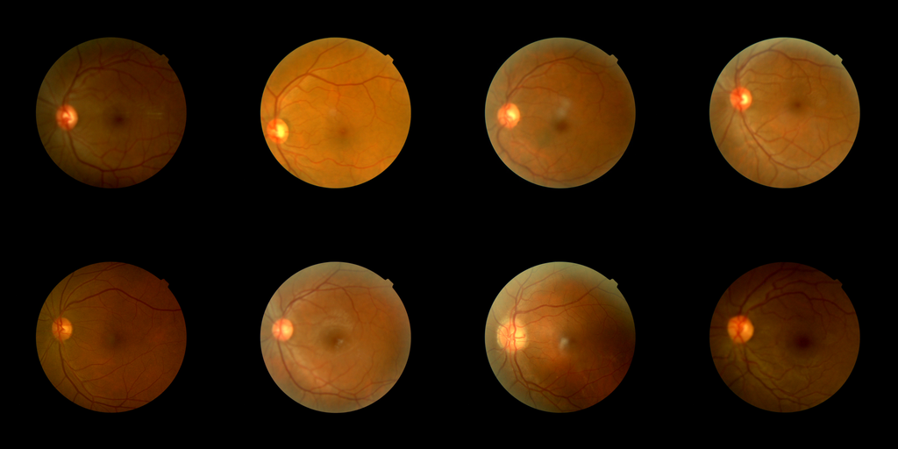
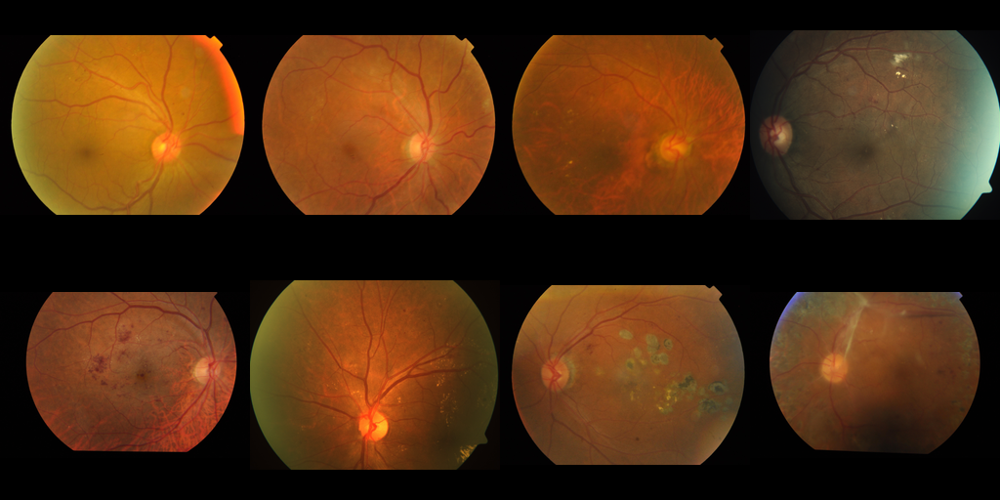
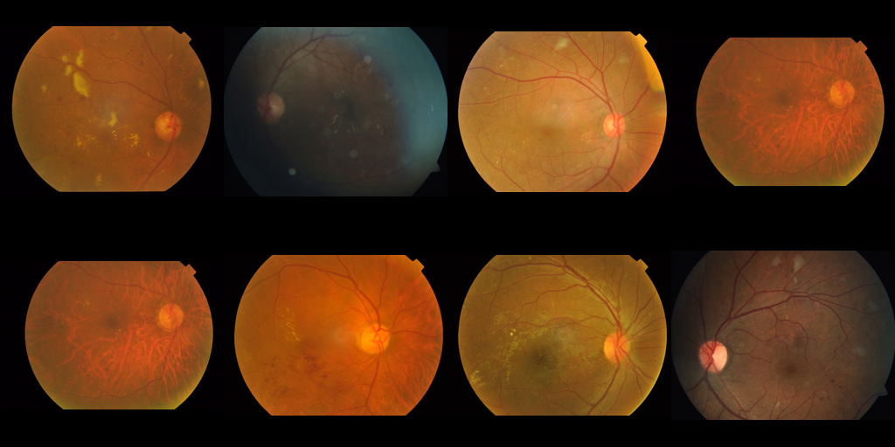
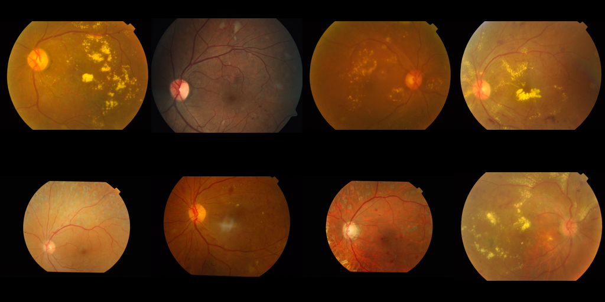
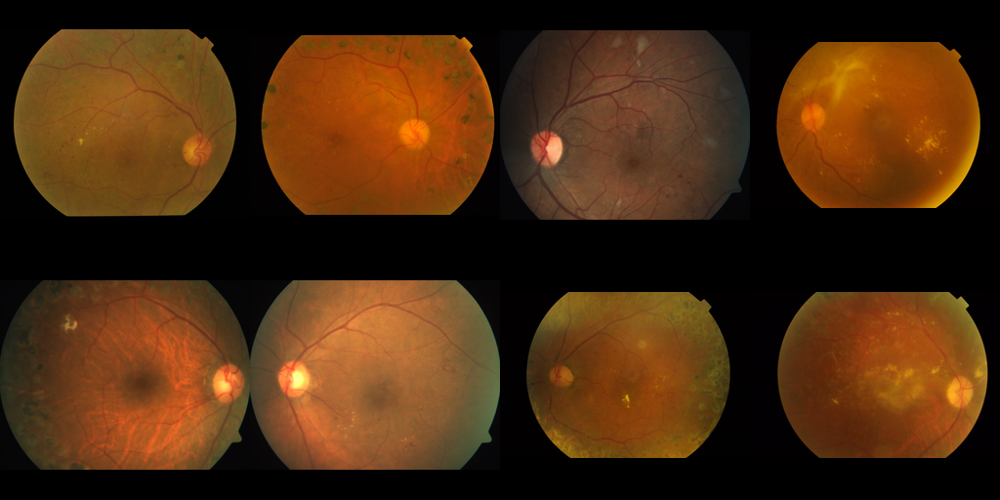

# RetinaGuard - APTOS 2019 Dataset Analysis Report

Generated by `ml/scripts/data_report.py`.
Strictly reflects empirical measurements from the ingested cohort.

---

## 1. Class Distribution Per Split

| ICDR Grade | Clinical Category | Train Count (Col %) | Val Count (Col %) | Test Count (Col %) | Total Images |
| :---: | :--- | :---: | :---: | :---: | :---: |
| **0** | No DR | 753 (48.2%) | 97 (37.6%) | 955 (51.9%) | **1805** |
| **1** | Mild NPDR | 153 (9.8%) | 30 (11.6%) | 187 (10.2%) | **370** |
| **2** | Moderate NPDR | 414 (26.5%) | 80 (31.0%) | 505 (27.4%) | **999** |
| **3** | Severe NPDR | 98 (6.3%) | 22 (8.5%) | 73 (4.0%) | **193** |
| **4** | Proliferative DR | 145 (9.3%) | 29 (11.2%) | 121 (6.6%) | **295** |
| **Total** | -- | **1563** | **258** | **1841** | **3662** |

---

## 2. Image Resolution & Morphology Statistics

| Metric | Width (px) | Height (px) | Aspect Ratio (W/H) |
| :--- | :---: | :---: | :---: |
| **Minimum** | 474 | 358 | 1.00 |
| **Maximum** | 4288 | 2848 | 1.51 |
| **Mean ± Std** | 2015.2 ± 884.2 | 1526.8 ± 542.6 | 1.28 ± 0.18 |
| **Median (IQR)** | 2144 (1050-2588) | 1536 (1050-1958) | 1.33 |

---

## 3. Optical Illumination & Focus Clarity Metrics

Computed inside the detected circular retinal aperture:

* **Laplacian Focus Variance (Blur)**:
  * Mean ± Std: `29.6 ± 22.4`
  * 5th – 95th Percentile: `5.4 – 63.6`
  * Range: `[3.1, 190.5]`
* **Mean Grayscale Luminance (0–255)**:
  * Mean ± Std: `88.0 ± 20.7`
  * 5th – 95th Percentile: `49.8 – 116.7`
  * Range: `[28.5, 156.2]`

---

## 4. Classical CV Quality Gate Audit

*Notice: Images failing the quality gate are documented here for clinical auditability. They are **not removed** from training/testing sets automatically.*

* **Total Images Scanned**: `3662`
* **Images Flagged by Quality Gate**: `3660` (`99.95%`)

### Quality Gate Failures by DR Grade

| ICDR Grade | Class Name | Total Class Images | Quality Gate Failures | Failure Rate (%) |
| :---: | :--- | :---: | :---: | :---: |
| **0** | No DR | 1805 | 1803 | 99.9% |
| **1** | Mild NPDR | 370 | 370 | 100.0% |
| **2** | Moderate NPDR | 999 | 999 | 100.0% |
| **3** | Severe NPDR | 193 | 193 | 100.0% |
| **4** | Proliferative DR | 295 | 295 | 100.0% |

### Triggered Quality Rejection Reasons

* **`BLUR`**: 3645 images (99.5%)
* **`RESOLUTION_TOO_LOW`**: 423 images (11.6%)
* **`INVALID_FOV`**: 70 images (1.9%)
* **`UNDEREXPOSED`**: 39 images (1.1%)

---

## 5. Per-Grade Representative Sample Grids

Each grid displays 8 representative fundus images from that diagnostic category.

### Grade 0 (No Diabetic Retinopathy)

### Grade 1 (Mild Non-Proliferative DR)

### Grade 2 (Moderate Non-Proliferative DR)

### Grade 3 (Severe Non-Proliferative DR)

### Grade 4 (Proliferative Diabetic Retinopathy)

